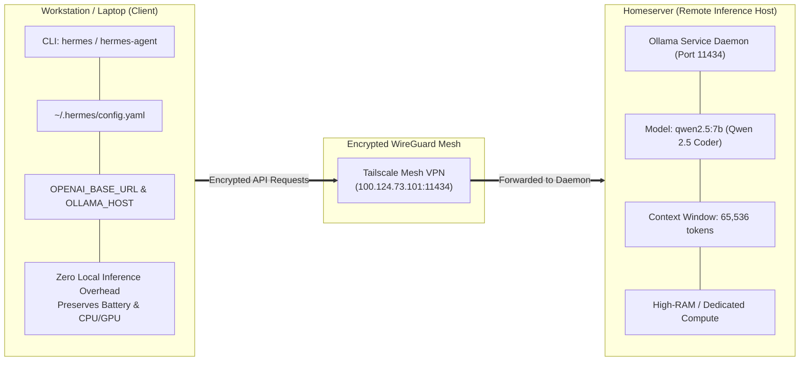

# AI Development Tools: Pi Coding Agent & Hermes

This guide details the AI development tooling configured in NixConfig, including the Pi terminal coding agent harness, the Hermes AI agent with local homeserver Ollama offloading, and developer CLI assistants.

---

## Overview

The configuration integrates autonomous and interactive AI coding tools designed for fast, local-first, and battery-conscious workflows across workstation and laptop environments:

| Tool | Primary Purpose | Host Execution & Backend | Nix Module Location |
| :--- | :--- | :--- | :--- |
| **Pi Coding Agent** | Terminal AI pair programmer & tool harness | Local CLI (`pi.nix`), Bubblewrap sandboxing option | `modules/features/apps/pi-agent.nix` |
| **Hermes AI Agent** | Autonomous multi-step agent & tool calling | Tailscale remote inference (`qwen2.5:7b` via homeserver Ollama) | `modules/features/apps/hermes.nix` |
| **Antigravity CLI** | AI assistant CLI | Local binary (`antigravity-cli`) | `modules/features/apps/development.nix` |
| **OpenCode** | Terminal AI assistant | Local binary (`opencode`) | `modules/features/apps/development.nix` |

---

## Pi Coding Agent

Pi is an extensible terminal coding agent harness packaged via `github:lukasl-dev/pi.nix`. It provides interactive code generation, file system manipulation, command execution, and prompt extensions.

### Configuration Options

The module `modules/features/apps/pi-agent.nix` provides declarative options exposed under `features.pi-agent`:

```nix
features.pi-agent = {
  enable = true;
  useBun = false;           # Set true to use Bun-built package variant
  jail.enable = false;      # Optional Bubblewrap sandbox isolation

  # Built-in extension toggles
  interactiveChoice = true; # Questionnaire tool for single/multi-choice select prompts
  question = false;         # Lightweight single-question choice prompt
  planMode = false;         # Adds /plan command & --plan flag for read-only exploration
  gitCheckpoint = true;     # Automatic Git stash checkpoints per turn for rollback
  protectedPaths = true;    # Blocks writes to sensitive paths (.env, .git/, node_modules/)
  permissionGate = false;   # Prompts for confirmation before destructive shell commands
  subagent = false;         # Delegates tasks to specialised subagents with isolated context

  # Custom extensions, skills, and rules
  extensions = [ ];         # Paths or TypeScript files passed via --extension
  skills = [ ];             # Directory paths passed via --skill
  rules = null;             # System prompt instructions or path to rules markdown
  settings = { };           # Merged into ~/.pi/agent/settings.json
};
```

### Host Configurations

Both `desktop` and `laptop` hosts have Pi enabled with safety extensions active:
- `interactiveChoice = true`: Enables questionnaire prompts for interactive selections.
- `gitCheckpoint = true`: Creates turn-by-turn stash checkpoints allowing seamless undo of unintended code changes.
- `protectedPaths = true`: Prevents modifications to `.env` files, `.git` metadata, and dependencies.

### Sandboxing with Bubblewrap (jail.nix)

When `features.pi-agent.jail.enable = true` is configured, Pi runs inside an unprivileged Bubblewrap sandbox (`jail.nix`), restricting filesystem writes strictly to the active workspace directory while allowing network access for API model calls.

### Binary Cache

The Pi module automatically registers the Cachix binary cache to eliminate long compilation times:
- Cache URL: `https://pi.cachix.org`
- Public Key: `pi.cachix.org-1:lGeoGJaZ5ZDabuRzkcD5EBTNnDM4HJ1vqeOxlWk1Flk=`

### Pi Agent Skills Suite & Build-Time Verification

NixConfig packages a dedicated suite of documentation, academic, and Typst skills in `modules/features/apps/pi-agent/skills/`, passed into Pi via `features.pi-agent.skills`:

| Skill | Purpose | Key Snippets & Conventions |
| :--- | :--- | :--- |
| **`assignment-report`** | University assignment reports | Assignment headers, problem-solution blocks, appendices |
| **`lab-notes`** | Laboratory experiment documentation | Equipment tables, step-by-step procedures, data logs |
| **`lecture-notes`** | Academic course lecture notes | `#definition`, `#theorem`, `#example`, `#warning`, `#takeaway` |
| **`revision-sheets`** | Compact exam revision sheets | Multi-column cheat sheets, formula summaries |
| **`test-notes`** | Software testing records | Test matrices, test-case definitions, edge-case tables |
| **`typst-snippets`** | Typst snippet library & conventions | Mathematical sets (`RR`, `NN`, `ZZ`, `QQ`, `CC`), `#uml-class`, diagrams |

Every skill contains an upstream-compatible `SKILL.md` adhering to the Agent Skills standard (YAML frontmatter with `name` and `description`).

#### Automated Verification Tooling
To prevent documentation drift and broken examples, NixOS tests all skills during derivation builds and CI:
- **`check-skills.sh`**: Validates `SKILL.md` frontmatter, verifies tool dependencies, and optionally compiles Typst code samples against `modules/packages/uni-notes/theme.typ`.
- **`check-sync.sh`**: Verifies that Typst preambles, fonts, page setups, and `#uml-class` conventions in `typst-snippets` remain 100% in sync with the `uni-notes` Typst theme.

### Usage

```bash
# Start an interactive pair programming session in current directory
pi

# Run with plan mode for read-only codebase exploration
pi --plan

# Run with a specific prompt
pi "refactor error handling in src/main.rs"
```

---

## Hermes AI Agent & Homeserver Ollama Offloading

Hermes is an autonomous agent framework developed by Nous Research, packaged and integrated in `modules/features/apps/hermes.nix`.

> [!NOTE]
> In the active configuration, Hermes is **disabled** (`features.hermes.enable = false`) across all hosts in favour of the **Pi Coding Agent**, which handles all pair-programming and refactoring workflows. The module remains available for on-demand use if remote Ollama agent invocation is needed.

### Battery-Saving Architecture

Running local large language models (LLMs) on a laptop rapidly drains battery and generates heavy thermal throttling. To solve this, NixConfig configures Hermes to offload inference to an Ollama instance running on the local homeserver:

1. **Local Wrappers**: NixOS installs `hermes` and `hermes-agent` wrapper scripts that execute `uvx --from hermes-agent` using system Python 3 and `uv`.
2. **Homeserver Tailscale Link**: Hermes connects over the encrypted Tailscale mesh network directly to the homeserver IP (`100.124.73.101:11434`).
3. **Dedicated Model**: Configured for `qwen2.5:7b` (Qwen 2.5 Coder 7B) with an expanded context window of 65,536 tokens (`ollama_num_ctx: 65536`).
4. **Zero Local Daemon Overhead**: `services.ollama.enable = false` ensures no local GPU or CPU inference daemons idle in the background.



### Declarative Config Generation

Managed declaratively via Hjem (`hjem.users."${config.username}".files.".hermes/config.yaml"`):

```yaml
# Hermes Agent Configuration - Managed via NixOS
model:
  default: "qwen2.5:7b"
  provider: "custom"
  base_url: "http://100.124.73.101:11434/v1"
  api_mode: "chat_completions"
  context_length: 65536
  ollama_num_ctx: 65536
```

### Environment Variables

Session environment variables exported globally:
- `HERMES_API_TIMEOUT = "1800"`: Extends timeout to 30 minutes for multi-step tasks.
- `OPENAI_BASE_URL = "http://100.124.73.101:11434/v1"`: Standard OpenAI-compatible API endpoint pointing to the homeserver.
- `OLLAMA_HOST = "100.124.73.101:11434"`: Ollama CLI remote host target.

### Usage

```bash
# Launch interactive Hermes agent
hermes

# Run an autonomous task with tool execution
hermes-agent "search for unused imports in modules/ and report findings"

# Check homeserver Ollama models via CLI client
ollama list
```

---

## Antigravity CLI & OpenCode

Included in `modules/features/apps/development.nix`:

- **Antigravity CLI** (`pkgs.unstable.antigravity-cli`): Advanced coding assistant CLI supporting code editing, subagents, and automated pair programming workflows.
- **OpenCode** (`pkgs.unstable.opencode`): Lightweight terminal AI assistant for code analysis and refactoring.
